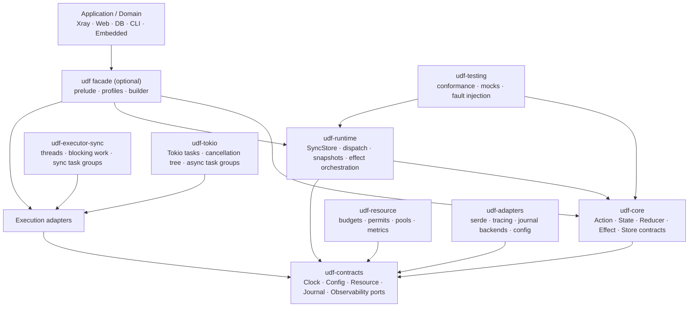
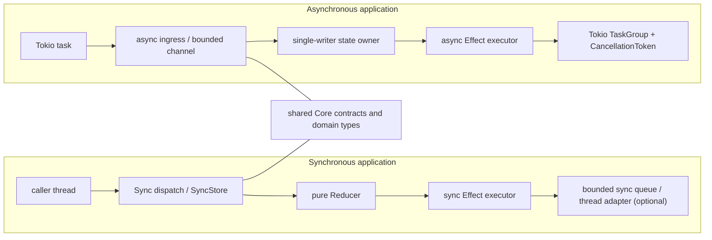

# UDF Target Architecture Blueprint

> Status: proposed target architecture (ADR seed)
> Scope: `udf-frame` as a reusable Rust framework; Xray is the first integration/validation consumer.
> Compatibility: evolutionary migration; do not rewrite the current crates in one step.

## 1. Product goal

UDF should make common application infrastructure safe, composable, observable, and easy to adopt. It is not intended to replace Tokio, the OS scheduler, allocators, databases, or application-specific architecture.

The product promise is **sensible defaults + opt-in capabilities + explicit resource/lifecycle semantics**. "Zero learning curve" is an aspiration for the happy path, not a literal guarantee: advanced users must still be able to configure execution, resource budgets, and failure policies.

Core principles:

1. Pay only for capabilities enabled/used.
2. Keep synchronous and asynchronous applications first-class.
3. Keep core contracts independent from concrete runtimes and I/O.
4. Make cancellation, shutdown, backpressure, and resource limits explicit.
5. Prefer safe Rust; isolate and document any unavoidable unsafe implementation.
6. Never claim a performance win without a reproducible benchmark and correctness evidence.
7. Keep protocol/application hot paths outside the generic state-management runtime unless profiling proves otherwise.

## 2. Target architecture



### Dependency rules

- `udf-core`: ideally zero third-party dependencies and no Tokio/IO.
- `udf-contracts`: small capability ports and value types; must not depend on concrete adapters.
- `udf-runtime`: synchronous state machine/store runtime. It must not require Tokio merely to use SyncStore.
- `udf-executor-sync`: optional synchronous/thread execution support.
- `udf-tokio`: optional Tokio adapter. Tokio types stay behind this crate's public adapter boundary.
- `udf-resource`: reusable budgets, permits, pools, and metrics. Allocator-specific storage stays in adapters/consumers.
- `udf-adapters-* `: integrations are independently feature/crate gated.
- `udf-testing`: conformance tests and test utilities; no production dependency path.
- `udf`: optional facade/re-export crate with ergonomic defaults. It must not force optional dependencies into minimal consumers.

The existing `skeleton`, `std-ext`, and `skeleton-infra` remain compatibility packages during migration. Do not rename all crates or break public APIs as the first step. Split only where dependency graphs and ownership boundaries justify it.

## 3. Synchronous and asynchronous model

Sync and async are two supported execution modes, not one abstraction that forces every caller to use async.



Rules:
- Reducers remain synchronous, deterministic, and side-effect free in both modes. Async I/O belongs in Effects/adapters.
- A synchronous consumer must not pull Tokio into its dependency tree.
- An async consumer may use the Tokio adapter; do not create a second async scheduler.
- Do not hide blocking work inside async executor workers. Route it to an explicitly bounded blocking executor.
- Do not force async traits into the core solely to make APIs look uniform. Share semantics and value types; let adapters expose idiomatic sync/async APIs.
- Queue bounds, overload behavior, ordering guarantees, and shutdown semantics must be documented for each mode.

## 4. Lifecycle and cancellation model

```mermaid
stateDiagram-v2
  [*] --> Running
  Running --> Closing: close gate / reject new work
  Closing --> Cancelling: signal cooperative cancellation
  Cancelling --> Draining: wait for owned work until deadline
  Draining --> Terminated: all owned work completed
  Draining --> TimedOut: deadline reached / report survivors
  TimedOut --> Terminated: ownership released; survivors explicitly reported
```



Keep separate operations and semantics:
- `close_gate`: stop accepting new work; does not imply cancellation.
- `cancel`: signal cooperative cancellation to owned work and descendants.
- `drain(deadline)`: wait for tracked work and collect outcomes.
- `abort`: runtime-specific best-effort task abort; not a universal guarantee for blocking threads.
- `shutdown(deadline)`: orchestrate the above and return a structured report.

Use a cancellation tree for parent-child propagation. In Tokio, use `CancellationToken` child tokens rather than one watcher task per child scope where semantics permit. The task registry remains a separate concern: cancellation signals do not prove that work has stopped.

A timeout means the caller stopped waiting. It does not mean a synchronous thread was forcibly terminated. Reports must distinguish completed, cancelled, panicked, failed, timed out, and still-running work.

## 5. Resource model

Separate enforcement from observation:

- `ResourceBudget`: configured hard limits (bytes, tasks, connections, queue slots).
- `ResourcePermit`: atomic/serialized reservation acquired before resource creation; RAII release.
- `ResourceMetrics`: borrowed/idle/high-water/denied counters; never used as the sole hard-limit authority.
- `PoolBackend`: allocation/reuse strategy owned by the consumer or adapter.
- `PoolPolicy`: idle retention, eviction, size classes, and overflow behavior.

A hard cap must use an atomic reservation/permit protocol (or a lock with a clear linearization point), not check-then-act metrics. Buffer allocation remains replaceable: Xray may keep `xray-buf` as its allocator while UDF provides generic permits and lifecycle-safe leases.

Avoid per-acquire heap allocations in lease/drop paths unless benchmarks justify them. Prefer concrete lease types or enum dispatch over boxed `FnOnce` closures in known hot paths, while retaining a generic extension point for uncommon backends.

## 6. Effect execution and backpressure

Effects should declare intent/policy rather than implicitly choosing an executor:
- Immediate: execute inline, bounded work only.
- Async: runtime-native async operation.
- Blocking: bounded blocking executor.
- CpuBound: optional CPU pool adapter.
- Deferred/Batch: explicit queue and flush policy.

Every queued execution path needs a capacity and overflow policy: wait, reject, drop-newest, drop-oldest, or caller-runs where semantically safe. Cancellation, deadline, retry budget, and shutdown drain behavior must be explicit. Avoid an executor abstraction that silently moves arbitrary work between sync and async contexts.

## 7. Proposed source tree (target, not an immediate migration instruction)

```text
udf/
├── Cargo.toml                    # workspace
├── crates/
│   ├── udf-core/                 # minimal UDF semantics and traits
│   │   └── src/{action,effect,reducer,store,subscription}.rs
│   ├── udf-contracts/            # runtime-neutral capability ports
│   │   └── src/{clock,config,resource,journal,observability}.rs
│   ├── udf-std/                  # cache/retry/backoff/rate-limit/scheduler
│   ├── udf-runtime/              # SyncStore, dispatch loop, snapshots, effects
│   ├── udf-executor-sync/        # sync task groups and bounded blocking pool
│   ├── udf-tokio/                # Tokio task groups, cancellation and adapters
│   ├── udf-resource/             # budgets, permits, pools, metrics
│   ├── udf-adapters/
│   │   ├── serde/
│   │   ├── tracing/
│   │   ├── journal-jsonl/
│   │   └── config-env/
│   ├── udf-testing/              # conformance and fault-injection utilities
│   └── udf/                      # optional facade/prelude/profiles
├── docs/
│   ├── architecture/
│   │   ├── target-architecture.md
│   │   ├── decisions/
│   │   └── diagrams/
│   ├── guides/
│   │   ├── quickstart-sync.md
│   │   ├── quickstart-tokio.md
│   │   └── choosing-executors.md
│   └── performance/
├── examples/
│   ├── sync-minimal/
│   ├── tokio-minimal/
│   ├── bounded-worker/
│   └── custom-resource-backend/
└── tests/
    ├── conformance/
    ├── lifecycle/
    ├── fault-injection/
    └── compatibility/
```

This tree is a destination proposal. The first migration should preserve the existing crate layout and extract boundaries incrementally.

## 8. Ergonomics and "zero-friction" adoption

Provide a layered experience:

1. **Minimal path:** one facade dependency and a tiny sync or Tokio quickstart.
2. **Guided defaults:** `Balanced` profile, safe queue bounds, clear shutdown defaults, and useful diagnostics.
3. **Opt-in capabilities:** resource pools, journal, tracing, CPU executor, etc. only when enabled.
4. **Advanced control:** users can inject their own executor, allocator, clock, journal, and policy.
5. **No hidden global runtime:** constructing a facade must not silently spawn threads or start background tasks unless the selected capability explicitly documents that behavior.

Cargo features are compile-time capability selection, not runtime dynamic plugin loading. If runtime loading is ever needed, it should be a separate plugin mechanism with an explicit security and ABI story.

Profiles are policy bundles, not magical universal optimizers:
- Balanced: conservative defaults and bounded queues.
- LowLatency: avoid unnecessary queues/hops; caller-runs only where safe.
- HighThroughput: batching and larger bounded queues where benchmarked.
- BoundedResource: strict budgets and fail-fast/reject behavior.

## 9. Safety, correctness, and performance gates

Before optimizing a primitive:
- define its linearization points and lifecycle invariants;
- add deterministic tests for races and failure paths;
- run stress tests and (where applicable) Loom/Miri;
- compare against a safe baseline;
- benchmark single-thread and contended workloads;
- report throughput, p50/p95/p99/p999, allocations/op, bytes/op, lock wait, queue depth, RSS, context switches, and task leaks.

For `SyncStore` unsafe internals:
- document every unsafe invariant adjacent to the code;
- maintain a safe reference implementation for differential tests;
- exercise reentrancy, panic, snapshot clone/drop, subscription and shutdown interleavings;
- run Miri and suitable concurrency model tests;
- do not remove the safe baseline until evidence supports doing so.

No lock-free queue, work-stealing scheduler, sharded JoinSet, or allocator rewrite should be accepted without a benchmark demonstrating a material improvement on representative workloads.

## 10. Xray integration boundary

Xray owns protocol semantics, socket I/O, buffer allocator choice, and proxy data-plane optimization. UDF owns reusable lifecycle, state-flow, generic resource-budget and execution contracts.

- Xray's network read/write/relay path stays on Tokio and protocol-native code.
- Xray's `xray-buf` remains the concrete buffer backend; UDF may provide permits/metrics.
- Xray should consume UDF via a narrow `xray-frame` facade rather than importing UDF implementation internals throughout `xray-core`.
- Instance/Framework lifecycle ownership must converge on one coordinator and one structured shutdown report.
- Dynamic inbound removal must release its scope registry ownership.

## 11. Migration order

1. Correctness fixes: thread creation rollback; scope unregister; resource permit semantics; shutdown timeout reporting.
2. Establish benchmarks and a safe SyncStore baseline; audit unsafe invariants.
3. Specify sync/async executor and lifecycle contracts with conformance tests.
4. Extract std-ext's runtime-neutral dependencies so it can be consumed without the UDF runtime.
5. Introduce optional adapters and a facade with sync/Tokio quickstarts.
6. Split crates only after dependency boundaries are stable and tested.
7. Validate with Xray and a second, structurally different application.

## 12. Non-goals

- Replacing Tokio or implementing a new general-purpose async runtime.
- Forcing every operation through Action/Reducer/Effect.
- Turning every network packet/read/write into a UDF dispatch.
- Claiming zero allocation or zero contention for all workloads.
- One executor/pool policy that is optimal for every application.
- Runtime dynamic loading via Cargo features.

## 13. Acceptance criteria for the architecture

- A sync-only consumer builds without Tokio in its dependency tree.
- A Tokio consumer can use task scopes and cancellation without spawning one watcher task per child scope.
- Core contracts can be implemented by a minimal third-party Store/Executor without depending on internal crates.
- Hard resource limits cannot be exceeded under concurrent acquisition.
- Shutdown reports distinguish timeout from actual termination.
- Optional adapters do not enter the dependency tree unless enabled.
- Both sync and async quickstarts are short, compile-tested examples.
- A second non-proxy application passes the same lifecycle/resource conformance suite.
